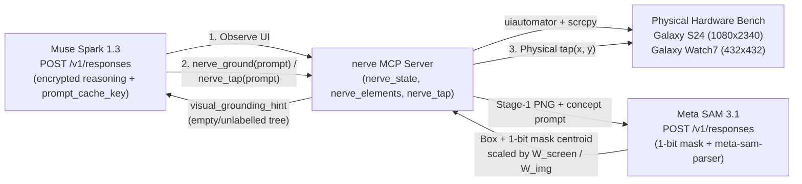
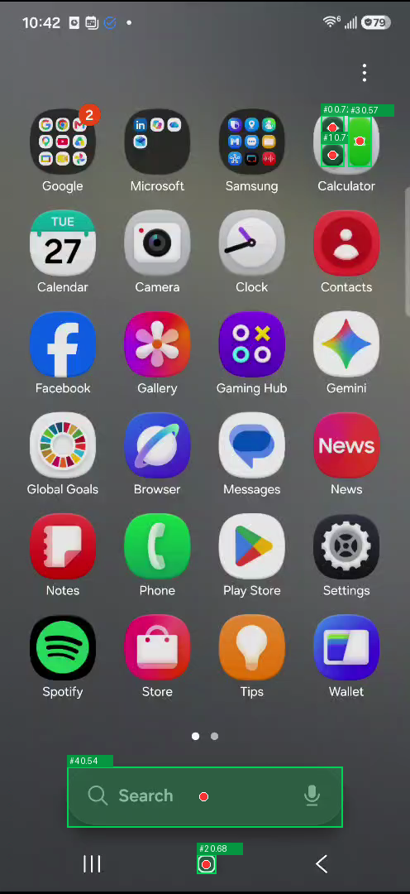
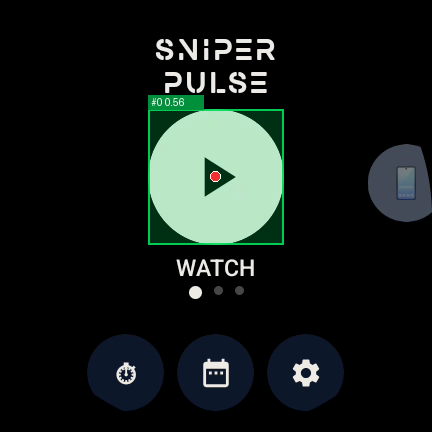

# `nerve-muse-sam` — Meta `Muse Spark 1.3` + `SAM 3.1` Physical-Device Mobile & Wear OS Agent

**Meta Global AI Developer Hackathon (Oct 26 – Nov 4, 2026) · Startup Track · Push the Frontier**

Give **Meta Muse Spark (`muse-spark-1.3`)** and **SAM 3.1 (`sam-3.1`)** hands and eyes on physical Android phones, Wear OS smartwatches, and iOS simulators via the Model Context Protocol (MCP) — evaluated under pre-registered confinement on [`mobile-agent-bench`](https://github.com/LincForge/mobile-agent-bench).

---

## 1. Hackathon Contribution Manifest (Oct 26 – Nov 4, 2026)

Per the Hackathon Startup Track rules (*"Startups may build on existing products or codebases, but you must clearly identify what was newly developed during the Hackathon"*), **100% of this repository** was created during the Oct 26 – Nov 4, 2026 Hackathon window, alongside the two upstream open-source PRs against baseline tag `pre-hackathon-2026-10-26`:

| Surface | Newly Built Hackathon Artifact (Oct 26 – Nov 4, 2026) | Upstream PR / Diff |
|---|---|---|
| **Visual Grounding (`SAM 3.1`)** | [`src/grounding.py`](src/grounding.py) + [`tests/test_grounding.py`](tests/test_grounding.py) — Promptable Concept Segmentation (`POST /v1/responses`, `model="sam-3.1"`), 1-bit base85 mask center-of-mass decoding via `meta-sam-parser==0.1.0`, multi-platform coordinate scaling (`1080x2340` Android phone, `432x432` Wear OS watch, iOS points), `nerve_ground` MCP tool, `nerve_tap(prompt=...)` semantic fallback, and green mask + red centroid overlay rendering. | [`LincForge/nerve` v0.2.0](https://github.com/LincForge/nerve/releases/tag/v0.2.0) · PyPI [`linc-nerve[grounding]==0.2.0`](https://pypi.org/project/linc-nerve/0.2.0/) (baseline `v0.1.0`) |
| **Agent Loop (`Muse Spark 1.3` + Open Weights)** | [`src/meta_agent.py`](src/meta_agent.py) + [`tests/test_meta_agent.py`](tests/test_meta_agent.py) — Native MCP stdio agent runner over `POST https://api.meta.ai/v1/responses` (and `/v1/chat/completions` for `meta-models/muse-spark-open-1026` / `meta-models/Muse-Glimmer-30B`), stateful `reasoning.encrypted_content` replay across tool calls, `prompt_cache_key` prefix caching, and confined `Read` multimodal screenshot injection. | [`LincForge/mobile-agent-bench#27`](https://github.com/LincForge/mobile-agent-bench/pull/27) ([`pre-hackathon-2026-10-26..hackathon/muse-sam`](https://github.com/LincForge/mobile-agent-bench/compare/pre-hackathon-2026-10-26...hackathon/muse-sam)) |
| **Live Physical Bench Evidence** | [`results/`](results/) & [`assets/`](assets/) — Sanitized transcripts, token/cache accounting (`meta.json`), and live `SAM 3.1` segmentation overlays captured on physical **Samsung Galaxy S24 (`1080x2340`)** and **Samsung Galaxy Watch7 (`SM-L300`, `432x432`)**. | In this repo |

---

## 2. Why This Matters: Solving the #1 Failure Mode of Mobile QA Agents

Mobile automation agents rely on `uiautomator dump` (Android) or accessibility trees to locate UI controls. In production apps, the accessibility tree frequently fails in three ways:
1. **Unlabelled custom canvases** (`androidx.compose.foundation.Canvas`, Flutter/Skia surfaces, custom icons with no `contentDescription`).
2. **60fps animations / game loops** where `uiautomator` times out waiting for an idle state.
3. **Compact Wear OS smartwatch surfaces** (`432x432` circular displays) with custom complication dials.

### Architecture: `Muse Spark 1.3` + `SAM 3.1` + `linc-nerve` MCP



### Key Technical Invariants Verified Against Live Meta APIs
1. **Stateful Encrypted Reasoning Replay (`/v1/responses`):**
   - Meta's `/v1/responses` endpoint is stateless when `store: false`. Our runner requests `"include": ["reasoning.encrypted_content"]` and `"reasoning": {"effort": "high"}`, replaying sealed `reasoning` items in exact turn order before `function_call` items.
2. **92.2% Prompt Cache Hit Rate via `prompt_cache_key`:**
   - Exposing 70 MCP device/debugger tools (nerve 48 + crucible 8 + spectra 14) plus `Read` on every turn would be expensive uncached (`$1.25/M` input tokens). Pinning a per-run `prompt_cache_key` across turns achieved a **92.2% cached-token ratio** (`434,621` cached / `471,556` total input tokens) on live multi-turn device operation, cutting a 14-turn physical smartwatch run to **$0.118** on `muse-spark-1.3` Standard (and **<$0.01** on `muse-spark-1.3-contributor`).
3. **Source-Pixel to Physical-Display Coordinate Scaling (`SAM 3.1`):**
   - `linc-nerve` captures Stage-1 `scrcpy` frames at `~496x1080` on the Galaxy S24 (`scale ≈ 2.177x`) and `432x432` (`scale = 1.0x`) on the Galaxy Watch7. `SAM 3.1` returns bounding boxes and 1-bit masks in source-image pixels `(W_img, H_img)`. `grounding.py` decodes the base85 1-bit raster via `meta_sam_parser.decode_mask_to_raster`, computes the true pixel center-of-mass, and scales to physical `ctrl.get_screen_size(device)` coordinates before passing through `nerve_tap`'s `0..32767` coordinate guard.

---

## 3. Live Physical Hardware Results

### A. `SAM 3.1` Visual Grounding Overlays (`nerve ground --annotate`)

| `c9` seeded build: unlabelled Compose `Canvas` Submit (S24) | Physical Galaxy S24 (`1080x2340`) | Physical Galaxy Watch7 (`SM-L300`, `432x432`) |
|---|---|---|
|  |  |  |

On the seeded `c9` build, `uiautomator` reports the Form screen's Submit control as an `android.widget.Button` at `[72,804][276,948]` with **no text, no content description and no resource id**. Its play-triangle icon is drawn with a Compose `Canvas`. `nerve ground --prompt "play button"` returned one target at `[72,817][274,934]` (confidence **0.84**) in physical S24 coordinates. That box sits inside the button's real bounds.

### B. `mobile-agent-bench` v3 Live Evaluation

Every run executes under strict confinement (`AGENT_CWD=/tmp/mab-agent-cwd`, no shell, no web, `READ_GUARD` blocking benchmark source/specs) against real physical devices:

| Task | Device | Model | Verdict | Wall Time | Turns | Input Tokens (Cached %) | Output Tokens | Total Cost (Standard) | Evidence |
|---|---|---|---:|---:|---:|---:|---:|---:|---|
| **`b11` (`wearos-mode-switch-ping`)** | Galaxy Watch7 (`SM-L300`, Wear OS 16) | `muse-spark-1.3` | **PASS** | **57.58s** | 14 | 471,556 (**92.2% cached**) | 1,631 | **$0.118** | [`meta.json`](results/b11_watch7_run1/meta.json) · [`transcript.jsonl`](results/b11_watch7_run1/transcript.jsonl) |

#### Phone grid on the Galaxy S24 (2026-10-27, `muse-spark-1.3-contributor`, 1 run per cell)

Run on a host where the S24 (`SM-S921U`, Android 16) was the **only** device in `adb devices`, matching the conditions of the Claude baseline grid. Every cell below was accepted on three checks: the host's `adb devices` count was 1 at run start, the cell's `meta.json` reports `device.model == "SM-S921U"`, and only one (redacted) serial appears in its transcript and stderr. The Muse runner's transcript carries `assistant` and `result` records only, so tool results are not in the transcript. Both `c9` answers were read by hand: each localizes the seeded **Tier selection not propagated** defect (the Form submit handler registers `Basic` whatever the dropdown shows, confirmed from `logcat`) as its first ship-blocker, before the regex verdict was accepted. `a6` (needs the watch as a distractor) and `b11` are reported separately.

| Column | Task | Device | Model | Verdict | Wall Time | Turns | Input Tokens (cached %) | Output Tokens | Cost | Evidence |
|---|---|---|---|---:|---:|---:|---:|---:|---:|---|
| `linc` | `a5` | SM-S921U | `muse-spark-1.3-contributor` | **PASS** | 51.6s | 13 | 468,124 (91.5% cached) | 1,584 | $0.005 | [`meta.json`](results/phone_s24/linc/a5/meta.json) · [`transcript.jsonl`](results/phone_s24/linc/a5/transcript.jsonl) |
| `linc-sam` | `a5` | SM-S921U | `muse-spark-1.3-contributor` | **PASS** | 46.7s | 13 | 481,716 (91.5% cached) | 1,416 | $0.005 | [`meta.json`](results/phone_s24/linc-sam/a5/meta.json) · [`transcript.jsonl`](results/phone_s24/linc-sam/a5/transcript.jsonl) |
| `linc` | `b10` | SM-S921U | `muse-spark-1.3-contributor` | **PASS** | 97.1s | 25 | 1,355,998 (92.9% cached) | 4,058 | $0.013 | [`meta.json`](results/phone_s24/linc/b10/meta.json) · [`transcript.jsonl`](results/phone_s24/linc/b10/transcript.jsonl) |
| `linc-sam` | `b10` | SM-S921U | `muse-spark-1.3-contributor` | **PASS** | 71.5s | 19 | 833,944 (92.8% cached) | 2,558 | $0.008 | [`meta.json`](results/phone_s24/linc-sam/b10/meta.json) · [`transcript.jsonl`](results/phone_s24/linc-sam/b10/transcript.jsonl) |
| `linc` | `b5` | SM-S921U | `muse-spark-1.3-contributor` | **PASS** | 323.0s | 90 | 4,538,882 (96.5% cached) | 10,014 | $0.027 | [`meta.json`](results/phone_s24/linc/b5/meta.json) · [`transcript.jsonl`](results/phone_s24/linc/b5/transcript.jsonl) |
| `linc-sam` | `b5` | SM-S921U | `muse-spark-1.3-contributor` | **PASS** | 361.4s | 96 | 5,653,468 (98.0% cached) | 10,012 | $0.024 | [`meta.json`](results/phone_s24/linc-sam/b5/meta.json) · [`transcript.jsonl`](results/phone_s24/linc-sam/b5/transcript.jsonl) |
| `linc` | `b6` | SM-S921U | `muse-spark-1.3-contributor` | **PASS** | 319.4s | 82 | 5,358,817 (98.2% cached) | 13,001 | $0.023 | [`meta.json`](results/phone_s24/linc/b6/meta.json) · [`transcript.jsonl`](results/phone_s24/linc/b6/transcript.jsonl) |
| `linc-sam` | `b6` | SM-S921U | `muse-spark-1.3-contributor` | **PASS** | 285.5s | 102 | 7,951,081 (98.6% cached) | 11,938 | $0.029 | [`meta.json`](results/phone_s24/linc-sam/b6/meta.json) · [`transcript.jsonl`](results/phone_s24/linc-sam/b6/transcript.jsonl) |
| `linc` | `b9` | SM-S921U | `muse-spark-1.3-contributor` | **PASS** | 67.5s | 17 | 713,704 (89.2% cached) | 2,453 | $0.009 | [`meta.json`](results/phone_s24/linc/b9/meta.json) · [`transcript.jsonl`](results/phone_s24/linc/b9/transcript.jsonl) |
| `linc-sam` | `b9` | SM-S921U | `muse-spark-1.3-contributor` | **PASS** | 34.8s | 11 | 408,837 (89.2% cached) | 1,283 | $0.005 | [`meta.json`](results/phone_s24/linc-sam/b9/meta.json) · [`transcript.jsonl`](results/phone_s24/linc-sam/b9/transcript.jsonl) |
| `linc` | `c10` | SM-S921U | `muse-spark-1.3-contributor` | **PASS** | 103.0s | 20 | 750,259 (94.2% cached) | 3,355 | $0.006 | [`meta.json`](results/phone_s24/linc/c10/meta.json) · [`transcript.jsonl`](results/phone_s24/linc/c10/transcript.jsonl) |
| `linc-sam` | `c10` | SM-S921U | `muse-spark-1.3-contributor` | **PASS** | 86.9s | 17 | 666,164 (93.3% cached) | 3,653 | $0.006 | [`meta.json`](results/phone_s24/linc-sam/c10/meta.json) · [`transcript.jsonl`](results/phone_s24/linc-sam/c10/transcript.jsonl) |
| `linc` | `c11` | SM-S921U | `muse-spark-1.3-contributor` | **PASS** | 123.8s | 25 | 1,024,343 (95.1% cached) | 5,135 | $0.008 | [`meta.json`](results/phone_s24/linc/c11/meta.json) · [`transcript.jsonl`](results/phone_s24/linc/c11/transcript.jsonl) |
| `linc-sam` | `c11` | SM-S921U | `muse-spark-1.3-contributor` | **PASS** | 99.8s | 24 | 949,409 (95.1% cached) | 3,481 | $0.007 | [`meta.json`](results/phone_s24/linc-sam/c11/meta.json) · [`transcript.jsonl`](results/phone_s24/linc-sam/c11/transcript.jsonl) |
| `linc` | `c9` | SM-S921U | `muse-spark-1.3-contributor` | **PASS** | 667.6s | 174 | 13,840,526 (99.0% cached) | 17,611 | $0.044 | [`meta.json`](results/phone_s24/linc/c9/meta.json) · [`transcript.jsonl`](results/phone_s24/linc/c9/transcript.jsonl) |
| `linc-sam` | `c9` | SM-S921U | `muse-spark-1.3-contributor` | **PASS** | 630.4s | 153 | 11,407,624 (98.0% cached) | 17,096 | $0.049 | [`meta.json`](results/phone_s24/linc-sam/c9/meta.json) · [`transcript.jsonl`](results/phone_s24/linc-sam/c9/transcript.jsonl) |

Per column: `linc` 8/8 PASS, $0.136 total, 1,753 s of agent time; `linc-sam` 8/8 PASS, $0.135 total, 1,617 s. Cells are in [`results/phone_s24/`](results/phone_s24/) (`<column>/<task>/`, sanitized at capture).

**What `linc-sam` did not do.** In all eight `linc-sam` cells the agent called `nerve_ground` **zero** times and never used `nerve_tap(prompt=...)`, even with `NERVE_GROUNDING=1` and both tools advertised (72 tools vs 71 in `linc`). On `c9` it tapped the unlabelled Canvas Submit by coordinates `(180, 877)`, inside the `[72,804][276,948]` bounds that `uiautomator` reports for the `android.widget.Button` even though the button has no text, content description or resource id. The element tree was enough for this task set, so the SAM column's pass rate says nothing about grounding; the overlays in section 3A are the evidence that grounding works, and they were produced with the `nerve ground` CLI, not by the agent inside a bench cell.

#### Voided cells (disclosed)

Two early `c9` attempts on 2026-10-27 (`muse-spark-1.3-contributor`) are **void** and are kept, not deleted ([`results/voided/`](results/voided/)):
1. **Harness turn cap.** The first Muse runner stopped at a hard-coded 40 turns. It cut the run off at 131 s of the task's 900 s budget, and graded a mid-task sentence. The Claude baseline cells on `c9` used 101–165 turns. Fixed in [`mobile-agent-bench@e20e04e`](https://github.com/LincForge/mobile-agent-bench/commit/e20e04e): the wall-clock timeout is now the binding budget, and a cap cut-off is flagged rather than graded.
2. **Wrong device.** Seven devices were attached to the bench host. The agent picked a Pixel 8 Pro running the *stock* APK from `nerve_discover`, instead of the S24 that the harness had reset with the *seeded* APK. The answer-regex matched "DO NOT SHIP" plus an unrelated "Tier dropdown" mention (regex PASS, 773.7 s, 187 turns, $0.063), but the answer said Tier worked. So it never found the seeded defect, and the cell counts as FAIL/void. The same cause voided Claude cells in July (`AMENDMENTS.md`). The fix is the same too: run with only the benchmark device attached.

#### Columns
- **`linc`**: the frozen, pre-registered v3 stack (`linc-nerve==0.1.0`). It has **no** SAM grounding, and the `b11` result above ran on it.
- **`linc-sam`**: a **non-pre-registered addendum column** ([`tools_addendum/linc-sam.yaml`](https://github.com/LincForge/mobile-agent-bench/blob/hackathon/muse-sam/tools_addendum/linc-sam.yaml)). It uses the same crucible/spectra pins with `linc-nerve[grounding]==0.2.0` and `NERVE_GROUNDING=1`. Its results are reported separately and never pooled with the frozen columns.

---

## 4. Reproduce Locally

```bash
# 1. Install nerve with the optional SAM 3.1 grounding extra (see the license note below)
uv venv && uv pip install 'linc-nerve[grounding]==0.2.0'

# 2. Ground any visual UI concept on a connected Android phone or Wear OS watch.
#    Grounding is opt-in because it uploads the screenshot to api.meta.ai.
export NERVE_GROUNDING=1
export META_AI_API_KEY="your-meta-api-key"
.venv/bin/nerve ground --device <adb-serial> --prompt "submit button" --annotate

# 3. Run mobile-agent-bench with Meta Muse Spark 1.3
git clone -b hackathon/muse-sam https://github.com/LincForge/mobile-agent-bench.git
cd mobile-agent-bench
BENCH_TASKS_DIR=tasks_v3 BENCH_RESULTS_DIR=results_v3_muse BENCH_DEVICE_SERIAL=<adb-serial> \
  uv run bench run --tool linc --task b11 --runs 1 --model muse-spark-1.3
```

### License and privacy notes
- Grounding depends on [`meta-sam-parser`](https://pypi.org/project/meta-sam-parser/), which is distributed under **Meta's SAM License, not Apache-2.0**. That license restricts some fields of use, including ITAR-controlled, military and weapons applications. nerve therefore ships it only as the optional `[grounding]` extra. Core `pip install linc-nerve` never installs or imports it. Read the SAM License before you install the extra.
- Every grounding call uploads the full device screenshot to Meta. Never enable `NERVE_GROUNDING=1` on a device that shows personal data.
- `nerve_tap(prompt=...)` taps only when there is one clear match: confidence ≥ 0.5, at least 0.1 ahead of the next match, and a known screen size. Otherwise it returns the candidates and taps nothing.

## License
The code in this repository is Apache-2.0 (see [LICENSE](LICENSE)). `meta-sam-parser`, which the grounding code imports, keeps its own SAM License.
